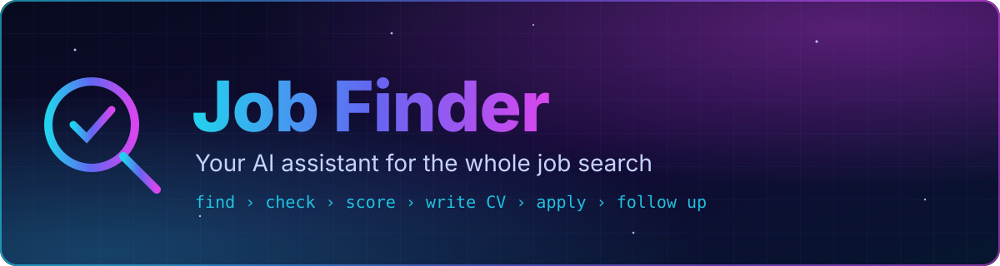
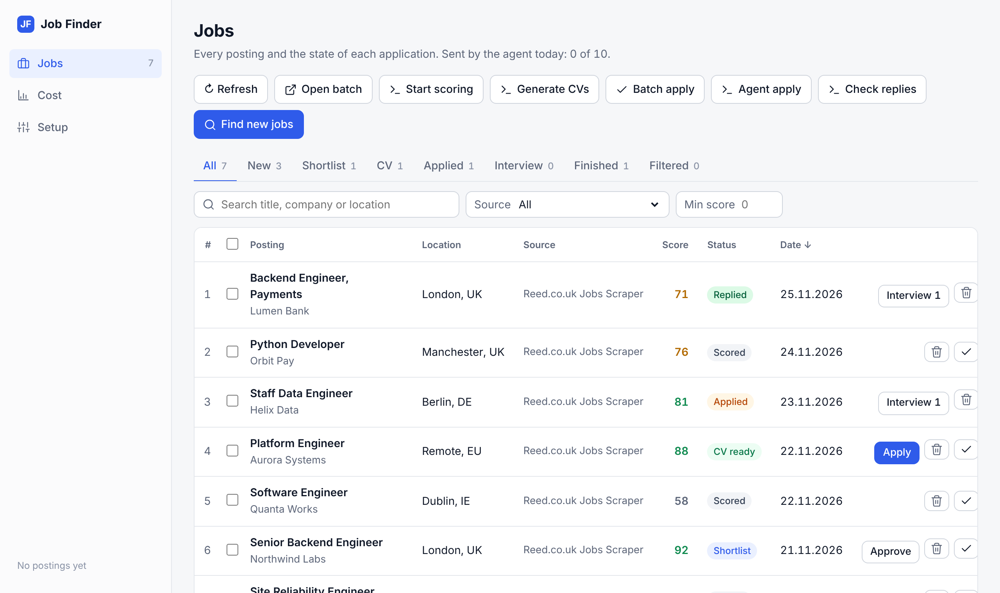
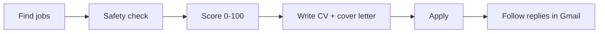
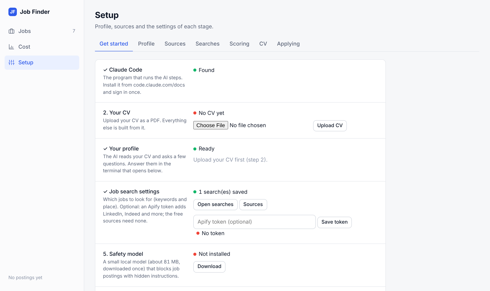

<p align="center">
  
</p>

<p align="center">
  
  
  
  
</p>

<p align="center">
  
</p>

Job Finder is a personal assistant for your job search. You give it your CV once. It then:

1. **finds** new job postings on several job sites,
2. **checks** them for scams and hidden tricks,
3. **scores** each one against your profile (0 to 100),
4. **writes** a CV and cover letter tailored to the best ones, using only true facts from your CV,
5. **applies** for you (you stay in control) and
6. **follows** the replies in your Gmail.



> **Platforms:** tested on **Linux and macOS**. **Windows is not supported yet** (the AI steps need a terminal that Windows does not have here). On Windows, use WSL or a Linux/macOS computer.

Everything is done from one web page that opens on your own computer. You never have to open or edit any code or settings file. Your CV and data stay on your computer.

> **Already installed?** Open the Terminal, go to the project folder, then run `uv sync` and `uv run jobfinder ui`. The page opens in your browser. Full steps are [below](#start-it-first-time).

## What you need

- A computer with **macOS or Linux** (the only tested systems). Windows is not supported yet.
- A **Claude account** (a paid plan such as Pro or Max) and **Claude Code**, the program that runs the AI. Install it from <https://code.claude.com/docs> and sign in once. The page tells you if it is missing.
- Your **CV as a PDF**.
- Optional: [Node.js](https://nodejs.org/), only for letting the AI fill in application forms for you.
- Optional: an [Apify](https://apify.com) account (free plan available) for more job sources such as LinkedIn and Indeed. Without it, the free sources still work.

## Start it (first time)

1. **Download** this project: on the GitHub page click **Code → Download ZIP**, then unzip it. (Or `git clone` if you know how.)
2. **Open the Terminal** (macOS: press `Cmd + Space`, type `Terminal`, press Enter. Linux: open your Terminal app).
3. **Go to the project folder.** Type `cd ` (with a space after it), drag the unzipped project folder into the Terminal window, then press Enter.
4. **Install the helper tool `uv`** (only the first time; skip if you already have it). Copy this line, paste it and press Enter, then **close the Terminal and open a new one**, and repeat step 3:

   ```
   curl -LsSf https://astral.sh/uv/install.sh | sh
   ```
5. **Install Job Finder** (only the first time, takes a few minutes):

   ```
   uv sync
   ```
6. **Optional, only if you installed Node.js** (lets the AI fill in application forms; only the first time):

   ```
   npx -y @playwright/mcp@0.0.83 install-browser chromium
   ```
7. **Start Job Finder:**

   ```
   uv run jobfinder ui
   ```

   Your browser opens a page at `http://127.0.0.1:8765/`. Keep the Terminal window open while you use the page; press `Ctrl + C` or close it to stop Job Finder.

**Next times:** open the Terminal, do step 3 again and run only step 7.

## Set it up (about 10 minutes, once)

<p align="center">
  
</p>

Open **Setup → Get started**. It lists the steps in order and shows a green dot when each is done:

1. **Claude Code**: must show "Found".
2. **Your CV**: choose your PDF and click **Upload CV**.
3. **Your profile**: click **Create profile**. A terminal opens at the bottom of the page. The AI reads your CV and asks a few questions (salary, work mode, languages, ...). Answer by typing in that terminal.
4. **Job search settings**: open **Searches**, add what you look for (for example keywords `product designer remote`, location `London, United Kingdom`) and click Save. In **Sources**, tick the job sites to use. If you have an Apify token, paste it on the *Get started* page and click **Save token**.
5. **Safety model**: click **Download** (about 81 MB, once). It helps block fake postings.
6. **Scoring, CV and applying**: the defaults work. The tabs **Scoring**, **CV** and **Applying** let you pick the AI model and limits, for example how many applications may be sent per day.

## Use it every day

Go to the **Jobs** page.

| Button | What it does |
|--------|--------------|
| **Find new jobs** (`/search`) | Fetches new postings, checks and scores them and shows the best ones |
| **Start scoring** | Scores postings that are not scored yet |
| **Write CV** / **Generate CVs** | Writes a tailored CV and cover letter (PDF) for the postings you choose |
| **Agent apply** (`/apply`) | The AI fills in the application forms in a browser window and asks you about anything it does not know. It stops at sign-in pages and CAPTCHAs, which you do yourself |
| **Check replies** (`/track`) | Reads Gmail (read-only) for answers from companies and updates each posting |

Click a posting to see its details, open its CV and cover letter, or mark it as applied if you applied by hand. The **Cost** page shows how many tokens the AI used.

You approve the applications: by default the AI shows what it filled in and waits for you before sending (change this in **Setup → Applying**).

<details>
<summary><b>If something goes wrong</b></summary>

- **The page shows "Claude Code: Not found"**: install Claude Code, open a new terminal or restart the computer, start Job Finder again.
- **The terminal buttons are greyed out**: same cause, or you are on Windows, which is not supported yet.
- **"Permission denied" or "command not found"**: you are probably not in the project folder: repeat step 3. For "uv: command not found", close the Terminal, open a new one and try again.
- **Port already in use**: Job Finder tries the next free port and prints the address in the Terminal window.
- **Gmail replies**: in claude.ai go to Settings → Connectors and connect Gmail once.
- **Start again from scratch**: close Job Finder and delete the `data` folder's contents (not the folder itself). This removes your CV, profile and postings.

</details>

## External resources

- **Claude Code** (the program that runs the AI): <https://code.claude.com/docs>
- **Safety model** (about 81 MB, Llama Prompt Guard 2 22M, downloaded for you by the **Download** button in Setup; the page it comes from): <https://huggingface.co/gravitee-io/Llama-Prompt-Guard-2-22M-onnx/tree/da68d0f6023c7aeaf6b256eec549de295d5e8740>
- **uv** (installs Python and the packages): <https://docs.astral.sh/uv/>
- **Node.js** (optional, only for the AI filling in application forms): <https://nodejs.org/>
- **Apify** (optional, more job sources): <https://apify.com>

<details>
<summary><b>Safety and privacy</b></summary>

- Your CV, profile and postings are stored only in the `data` folder on your computer and are never uploaded to GitHub.
- The Apify token is saved in a private `.env` file and is never shown again on the page.
- Job postings and emails are treated as untrusted text: postings that ask for money or carry hidden instructions to an AI are blocked before any AI reads them, and the AI agents that read postings or mail cannot send mail, run commands or apply.
- Nothing is invented: generated documents use only facts that are in your profile.

</details>

## For developers

Command-line use, architecture and the rules of the code are in [docs/overview.md](docs/overview.md), [docs/architecture.md](docs/architecture.md), [docs/commands.md](docs/commands.md), [docs/data.md](docs/data.md) and [docs/plan.md](docs/plan.md). Tests: `uv run pytest`.

## License

[MIT](LICENSE). The safety model it downloads has its own license (Llama 4 Community License); see its page under External resources.
